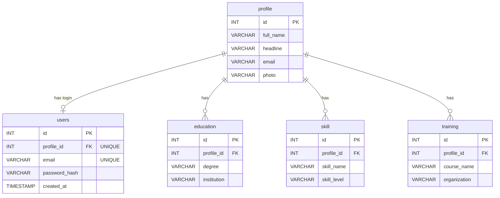
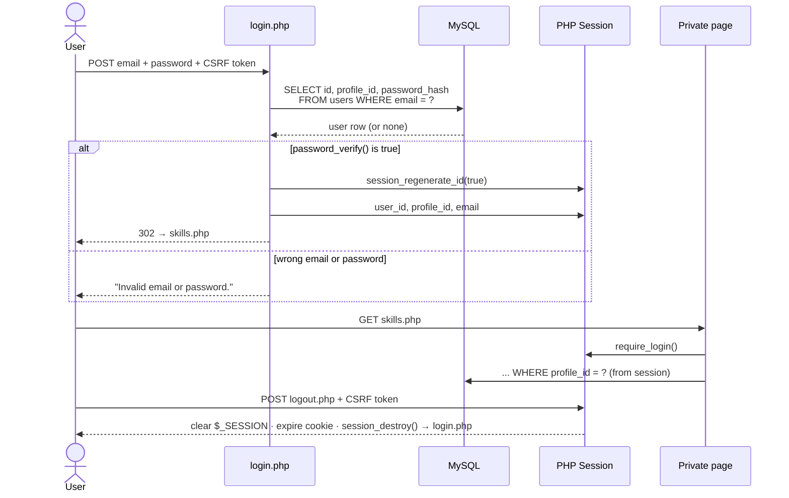
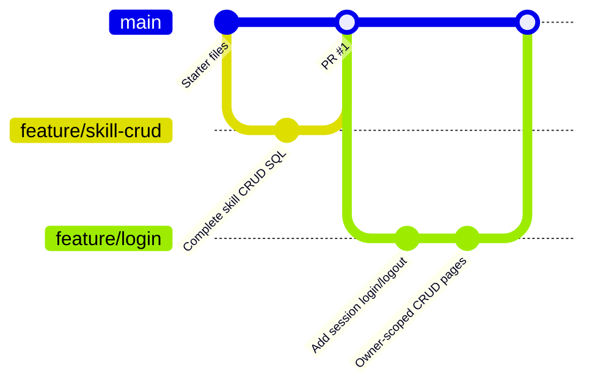

<div align="center">

<!-- ══════════════════════════════════════════════════════════ -->
<!--                     HERO SECTION                          -->
<!-- ══════════════════════════════════════════════════════════ -->

# ☕ Resume Lab — PHP Session Login & Skill CRUD

### Database Management · Burapha University · Faculty of Informatics

<br/>

[](https://www.php.net/)
[](https://www.mysql.com/)
[](https://www.phpmyadmin.net/)
[](https://git-scm.com/)
[](https://angsila.informatics.buu.ac.th)

<br/>

> *A personal resume website backed by MySQL — every visitor signs up,*
> *logs in with a hashed password, and manages only their own skills.*

<br/>

```
register → login (password_verify + session) → owner-scoped CRUD → logout (POST + CSRF)
```

<br/>

</div>

---

<!-- ══════════════════════════════════════════════════════════ -->
<!--                   QUICK STATS                             -->
<!-- ══════════════════════════════════════════════════════════ -->

<div align="center">

|  🗄️ Tables  |  🔐 Auth  |  ✏️ CRUD  |  🧪 Test Cases  |  🛡️ SQL Injection  |
|:---:|:---:|:---:|:---:|:---:|
| 5 (InnoDB) | Session + bcrypt | INSERT · SELECT · UPDATE · DELETE | **7 / 7 passed** | Prepared statements only |

</div>

---

<!-- ══════════════════════════════════════════════════════════ -->
<!--                   TABLE OF CONTENTS                       -->
<!-- ══════════════════════════════════════════════════════════ -->

## 📋 Table of Contents

- [✨ Overview](#-overview)
- [🧭 Pages](#-pages)
- [📁 Project Structure](#-project-structure)
- [🗄️ Database Schema](#️-database-schema)
- [🔐 Login / Logout Flow](#-login--logout-flow)
- [🧩 Lab Tasks & SQL](#-lab-tasks--sql)
- [⚙️ Setup](#️-setup)
- [🧪 Test Cases](#-test-cases)
- [🛡️ Security](#️-security)
- [🌿 Git Workflow](#-git-workflow)
- [📦 Deliverables](#-deliverables)

---

<!-- ══════════════════════════════════════════════════════════ -->
<!--                      OVERVIEW                             -->
<!-- ══════════════════════════════════════════════════════════ -->

## ✨ Overview

This repository continues the PHP/MySQL **Resume Lab** across two weeks of the Database Management course.

| Week | Topic | What was built |
|:----:|-------|----------------|
| **1** | Resume CRUD Lab | Complete `INSERT`, `SELECT`, `UPDATE`, `DELETE` for the `skill` table with prepared statements |
| **2** | PHP Login / Logout | Register, session login, secure logout, and private pages scoped to the logged-in user |

### Highlights

- ☕ **Minimal coffee theme** resume page with light / dark mode and a certificate lightbox
- 🔐 **Passwords never stored in plain text** — `password_hash()` on register, `password_verify()` on login
- 🔄 **Session fixation protection** — `session_regenerate_id(true)` after every successful login
- 👤 **Owner-scoped data** — every query filters by `profile_id` from the session, so users never see each other's records
- 🧾 **CSRF tokens** on every form that changes data, including logout
- 🙈 **No secrets in Git** — real database credentials live in an ignored `secret/` folder

---

<!-- ══════════════════════════════════════════════════════════ -->
<!--                        PAGES                              -->
<!-- ══════════════════════════════════════════════════════════ -->

## 🧭 Pages

| Page | Access | Purpose |
|------|:------:|---------|
| `register.php` | 🌐 Public | Create an account — also creates a new empty profile |
| `login.php` | 🌐 Public | Sign in with email + password |
| `index.php` | 🔒 Login | Resume page of the logged-in user |
| `skills.php` | 🔒 Login | List the user's skills (**SELECT**) |
| `skill_create.php` | 🔒 Login | Add a skill (**INSERT**) |
| `skill_edit.php` | 🔒 Login | Edit one skill (**SELECT + UPDATE**) |
| `skill_delete.php` | 🔒 Login | Confirm and remove a skill (**DELETE**) |
| `logout.php` | 🔒 Login | Confirm logout and destroy the session |

---

<!-- ══════════════════════════════════════════════════════════ -->
<!--                  PROJECT STRUCTURE                        -->
<!-- ══════════════════════════════════════════════════════════ -->

## 📁 Project Structure

```
DB-Week12/
├── 📄 index.php                 # Resume page (private, owner-scoped)
├── 🔐 auth.php                  # Session settings, require_login(), CSRF helpers
├── 🔐 register.php              # Sign up → profile + users rows in one transaction
├── 🔐 login.php                 # TODO 1–5: prepared SELECT, password_verify, session
├── 🔐 logout.php                # TODO 6: POST + CSRF, clear session and cookie
├── ⚙️ crud_bootstrap.php         # Shared CRUD setup: DB, login guard, page layout
├── ✏️ skills.php                 # SELECT list
├── ✏️ skill_create.php           # INSERT
├── ✏️ skill_edit.php             # SELECT + UPDATE
├── ✏️ skill_delete.php           # DELETE
├── 📂 config/
│   └── db.php                   # mysqli connection (reads secret/config.php)
├── 📂 database/
│   ├── setup.sql                # Week 1 schema + demo data (⚠️ DROPs tables)
│   └── this_week_migration.sql  # Week 2: creates `users` only (non-destructive)
├── 📂 assets/
│   ├── css/style.css            # Coffee resume theme
│   ├── css/crud.css             # CRUD + auth page styles
│   └── images/                  # 🙈 git-ignored (profile photo, certificates)
└── 📂 secret/                   # 🙈 git-ignored (real DB credentials)
```

---

<!-- ══════════════════════════════════════════════════════════ -->
<!--                    DATABASE SCHEMA                        -->
<!-- ══════════════════════════════════════════════════════════ -->

## 🗄️ Database Schema



All foreign keys use `ON DELETE CASCADE`, so deleting a profile removes its user account and records.

---

<!-- ══════════════════════════════════════════════════════════ -->
<!--                  LOGIN / LOGOUT FLOW                      -->
<!-- ══════════════════════════════════════════════════════════ -->

## 🔐 Login / Logout Flow



### How the session works

| Step | What happens | Why |
|:----:|--------------|-----|
| **01** | Server creates a session and sends only a session ID cookie (`HttpOnly`, `SameSite=Lax`) | Login state stays on the server, not in the browser |
| **02** | On successful login the session ID is regenerated | Prevents session fixation attacks |
| **03** | `user_id` and `profile_id` are stored in `$_SESSION` | Every private page knows who the user is |
| **04** | `require_login()` runs at the top of each private page | No session → redirect to `login.php` |
| **05** | Logout clears the session data, expires the cookie and destroys the session | Back / refresh can no longer open private pages |

---

<!-- ══════════════════════════════════════════════════════════ -->
<!--                    LAB TASKS & SQL                        -->
<!-- ══════════════════════════════════════════════════════════ -->

## 🧩 Lab Tasks & SQL

### Week 1 — Skill CRUD

| TODO | File | SQL |
|:----:|------|-----|
| 1 | `skill_create.php` | `INSERT INTO skill (profile_id, skill_name, skill_level) VALUES (?, ?, ?)` |
| 2a | `skill_edit.php` | `SELECT skill_name, skill_level FROM skill WHERE id = ? AND profile_id = ?` |
| 2b | `skill_edit.php` | `UPDATE skill SET skill_name = ?, skill_level = ? WHERE id = ? AND profile_id = ?` |
| 3 | `skill_delete.php` | `DELETE FROM skill WHERE id = ? AND profile_id = ?` |

> [!IMPORTANT]
> **Why `UPDATE` and `DELETE` need `WHERE`** — without it, the statement changes or removes **every row** in the table.
> `id = ?` targets one record, and `AND profile_id = ?` makes sure it belongs to the current user.

### Week 2 — Login / Logout

| TODO | File | Implementation |
|:----:|------|----------------|
| 1 | `login.php` | `SELECT id, profile_id, password_hash FROM users WHERE email = ? LIMIT 1` |
| 2 | `login.php` | `mysqli_stmt_bind_param` → `execute` → `bind_result` → `fetch` |
| 3 | `login.php` | `password_verify($password, $hash)` — never compare plain passwords |
| 4 | `login.php` | `session_regenerate_id(true)` and store `user_id`, `profile_id`, `email` |
| 5 | `login.php` | `header('Location: skills.php'); exit;` |
| 6 | `logout.php` | Check CSRF → `$_SESSION = []` → expire cookie → `session_destroy()` → redirect |

### Extra — Owner-scoped pages

| File | Change |
|------|--------|
| `crud_bootstrap.php` | Calls `require_login()`; `profile_id()` now returns `$_SESSION['profile_id']` instead of the first profile; adds a **Logout** link |
| `index.php` | Requires login and loads the profile and education of the logged-in user with prepared statements |

---

<!-- ══════════════════════════════════════════════════════════ -->
<!--                         SETUP                             -->
<!-- ══════════════════════════════════════════════════════════ -->

## ⚙️ Setup

> [!WARNING]
> **Do not re-import `database/setup.sql` on a database with real data** — it starts with `DROP TABLE`.
> Back up the database in phpMyAdmin first.

**1. Database** — in phpMyAdmin, select your existing database, open the **SQL** tab and run
`database/this_week_migration.sql` (it only creates the `users` table and is safe to run twice).

**2. Credentials** — create `secret/config.php` (ignored by Git):

```php
<?php
$DB_HOST = 'localhost';
$DB_USER = 'your_db_user';
$DB_PASS = 'your_db_password';
$DB_NAME = 'your_db_name';
```

**3. Deploy** — upload the project to your permitted folder on Angsila (e.g. with FileZilla), including `secret/` and `assets/images/`.

**4. Try it** — open `register.php`, create an account (password ≥ 10 characters), then log in.

---

<!-- ══════════════════════════════════════════════════════════ -->
<!--                       TEST CASES                          -->
<!-- ══════════════════════════════════════════════════════════ -->

## 🧪 Test Cases

| # | Scenario | Expected | Result |
|:-:|----------|----------|:------:|
| 1 | Open `skills.php`, `index.php`, create / edit / delete without login | Redirect to `login.php` | ✅ |
| 2 | Login with correct password / wrong password | Success / *"Invalid email or password."* | ✅ |
| 3 | Logout, then press Back or refresh a private page | Redirect to `login.php` | ✅ |
| 4 | User B opens or deletes User A's skill by ID | Not visible · edit returns 404 · row unchanged | ✅ |
| 5 | Create → Edit → Delete after login | Each change appears in the list | ✅ |
| 6 | Email `' OR '1'='1` and `x'or'1'='1@example.com` | Login rejected | ✅ |
| 7 | Repository contains no real DB password or `.env` | Clean | ✅ |

---

<!-- ══════════════════════════════════════════════════════════ -->
<!--                        SECURITY                           -->
<!-- ══════════════════════════════════════════════════════════ -->

## 🛡️ Security

| Threat | Protection |
|--------|-----------|
| SQL injection | Prepared statements with bound parameters on every query that uses input |
| Password leaks | `password_hash()` (bcrypt) — the database stores only hashes |
| Session fixation | `session_regenerate_id(true)` on login, strict mode, cookie-only sessions |
| CSRF | Random token checked with `hash_equals()` on every POST |
| XSS | All output escaped with `htmlspecialchars()` |
| Viewing others' data | `WHERE ... AND profile_id = ?` using the session value |
| Cached private pages | `Cache-Control: no-store` on private pages |
| Secrets in Git | `secret/`, `.env`, `assets/images/` listed in `.gitignore` |

> [!NOTE]
> This is a **teaching lab**. A production app would also need HTTPS enforcement, login throttling,
> session timeouts, centralized permissions and monitoring.

---

<!-- ══════════════════════════════════════════════════════════ -->
<!--                      GIT WORKFLOW                         -->
<!-- ══════════════════════════════════════════════════════════ -->

## 🌿 Git Workflow



Each week is developed on its own feature branch and merged into `main` through a Pull Request.

---

<!-- ══════════════════════════════════════════════════════════ -->
<!--                      DELIVERABLES                         -->
<!-- ══════════════════════════════════════════════════════════ -->

## 📦 Deliverables

| | Item |
|:-:|------|
| **A** | GitHub repository (source code, no secrets) |
| **B** | Running Angsila URL or instructor-approved local demo |
| **C** | Screenshots: register, successful login, failed login, CRUD, logout |
| **D** | Short explanation of the session and login / logout flow ([see above](#-login--logout-flow)) |

---

<!-- ══════════════════════════════════════════════════════════ -->
<!--                       FOOTER                              -->
<!-- ══════════════════════════════════════════════════════════ -->

<div align="center">

<br/>

Made with ☕ by **[68160064 Phattaradanai Suwannahong](https://github.com/68160064PhattaradanaiSuwannahong)**

*Faculty of Informatics · Burapha University*

*PHP · MySQL · Sessions · Prepared Statements*

<br/>

</div>
